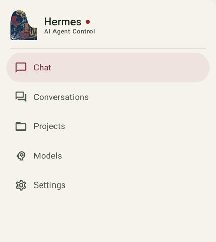
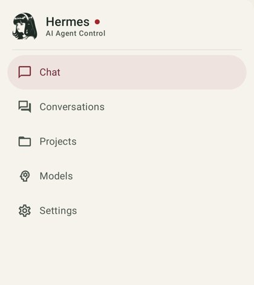
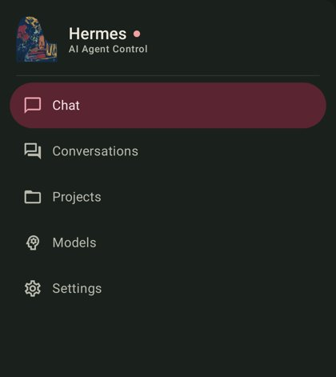
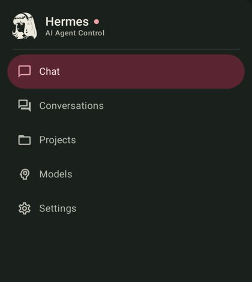

# Fourche noronuke/hermes-mobile

Reprise de [Hy4ri/hermes-mobile](https://github.com/Hy4ri/hermes-mobile) (Apache 2.0), version amont dans `VERSION_AMONT`.

Ce qui change par rapport à l'amont :

- identifiant `com.noronuke.hermes`, nom « Hermes », signature propre (clé hors dépôt sur le NUC, `~/.hermes/cles/hermes-noronuke.keystore`, en secret GitHub `KEYSTORE_B64` ; mot de passe au coffre Hermes sous `HERMES_MOBILE_KEYSTORE_PASSWORD`, en secret GitHub `KEYSTORE_PASSWORD`) ;
- traduction française complète (`app/src/main/res/values-fr/`), produite par `outils/traduire_strings.py` puis relue ;
- menu réduit à Conversation, Historique, Projets, Modèles, Réglages (`Allegement.kt`) ; écrans de configuration, secrets, journaux, fichiers, passerelle et fournisseurs refusés depuis tout point d'entrée ;
- présentation dans l'esprit de l'appli Claude : palette « Argile » à la place du thème par défaut, bulle de l'utilisateur neutre, réponses en police à empattements ;
- vérification de mise à jour interne coupée (elle interrogeait l'amont, dont l'APK n'est pas installable par-dessus le nôtre) : les mises à jour passent par Obtainium ;
- une seule fabrique (`.github/workflows/compilation.yml`) au lieu de celles de l'amont.

Remise à niveau automatique : `~/.hermes/scripts/hermes-mobile-amont.sh` (cron hebdomadaire), qui s'arrête et prévient en cas de conflit. À la main : `git fetch amont && git merge amont/main`, régler les conflits (en général `strings.xml`, `Navigation.kt`), relancer `outils/traduire_strings.py` pour les chaînes nouvelles (il ne retraduit pas ce qui l'est déjà), mettre à jour `VERSION_AMONT`.

## Présentation « Maquis » (25/10/2026)

Refonte visuelle demandée par Baptiste (« boutons arrondis dans des carrés »), d'après la charte commune des applis (`Projet_Hermes/06 — Application/_IA/Charte des applis (26-10).md`). Aucune fonction ne change ; seuls thème, couleurs, formes, espacements et libellés affichés.

- **Palette** `theme/presets/DefaultScheme.kt` : crème `#F2EFE6`, papier `#FAF8F2`, filet `#DFDCCF`, encre `#1F2A24`, accent bordeaux `#7D2E3A` (sombre : nuit `#151B17`, texte crème, bordeaux éclairci `#E7A1AB`). Contrastes calculés : encre/fond 12,9:1 (sombre 14,3:1), accent/fond 7,9:1 (8,4:1), toutes les paires des tests ≥ 4,5:1. Pas de voile teinté sur les surfaces surélevées (`Theme.kt`).
- **Formes** `theme/Shapes.kt`, objet `Formes` : Fin 6, Contrôle 12, Carte 16, Bulle 20, Feuille 28, Puce ronde ; les rayons écrits en dur sont ramenés à ces familles. Règle : jamais un élément arrondi posé dans un carré.
- **Écrans** : cartes de conversation papier au filet fin (plus de cadre épais coloré), pastilles de 10 dp (bleu, vert, gris visible au repos), étiquette d'état en puce discrète ; barre de saisie flottante de 28 dp sur papier ; bulle envoyée en bordeaux, coin de départ en bas à droite ; raisonnements et outils en blocs papier au filet ; recherche en pilule de 48 dp ; tiroir à pilule de sélection décollée du bord, icônes au trait, en-tête au logo d'Hermes (silhouette de l'icône, à l'encre, posée sur le fond du tiroir ; le couvercle de piano coloré a été retiré le 26/10) ; conversation neuve illustrée par le pianiste du site (un WebP de 32 Ko, `res/drawable-nodpi/fourche_illu_*`) ; libellés anglais restants traduits (`fourche_*` dans les deux `strings.xml`).
- **Fabrique d'essai** `.github/workflows/essai.yml` : toute poussée sur une branche `essai/**` compile et passe toute la suite de tests en `continue-on-error`, avec le décompte dans le résumé. La suite complète a 35 échecs **hérités** de la fourche (vérification de mise à jour coupée, verrou de profil, réglages cosmétiques retirés), identiques sur `main` avant la refonte (branche `essai/temoin`) ; la fabrique principale ne lance que les tests des thèmes.
- **Captures avant/après** : hors dépôt (le dépôt est public et les titres de conversation sont privés), dans `Projet_Hermes/06 — Application/_IA/coup-de-frais-2610/hermes/`.
- Reste un écart assumé avec la charte : la prose des réponses garde sa police à empattements (le « style Claude » que Baptiste aime) ; à repasser en police système s'il le préfère.

## Connexion : garde « réseau local » d'Android 17 (26/10/2026)

Tailscale donne au NUC une adresse 100.64/10, qu'Android 17 range dans le « réseau local » : une appli
qui vise l'API 37 doit avoir la permission `ACCESS_LOCAL_NETWORK`, sinon le système bloque la connexion
sans rien dire. La garde de démarrage (`MainActivity.SavedSessionLanGate`) décidait de vérifier cette
permission en résolvant le nom du serveur ; si la résolution échouait au lancement, elle concluait
« pas de réseau local » et laissait passer. Depuis le 26/10, un nom MagicDNS (`*.ts.net`) est reconnu
comme local sur le nom seul (`LocalNetwork.isTailscaleMagicDnsName`) : la permission est toujours
vérifiée, et demandée si elle manque, au lieu d'un « Non connecté » muet.

### Captures du tiroir (26/10/2026)

Rendus hors appareil (Robolectric, branches `essai/captures-tiroir-avant` et `-apres`), libellés en anglais (langue du rendu), données fictives.

| Avant (couvercle coloré) | Après (logo d'Hermes) |
|---|---|
|  |  |
|  |  |

Logo : silhouette de l'avant-plan de l'icône (`res/drawable-nodpi/fourche_logo.webp`, 9 Ko), teinte `onSurface` : encre `#1F2A24` sur papier en clair (≈ 13:1), crème `#ECE8DC` sur nuit en sombre (≈ 14:1). Aucun cadre ni disque autour.

### Sélecteur de bot (27/10/2026)

Branche `essai/selecteur-bots`, reprise de la branche `simon/multi-bots` de
`noronuke/hermes-mobile-simon` (Simon) : un sélecteur de profil Hermes en tête du
tiroir, le nom lisible du bot affiché, textes en français et en anglais.

La bascule est **locale** : `Allegement.profilCollantServeur = false` fait sauter le
`POST /api/profiles/active`, les requêtes portent le profil (l'intercepteur et le
WebSocket s'en chargent), le profil par défaut du serveur n'est jamais touché — des
scripts et la passerelle s'appuient dessus. Les tests de l'amont, qui décrivent le
profil collant, repassent le drapeau à `true` dans leur `setUp`.

Compilé et éprouvé sur le NUC (JDK 21 + `~/Android/Sdk`) : `:app:compileDebugKotlin`
passe, `ProfileSwitchCoordinatorTest` fait 11 tests, 0 échec, dont « bascule locale
sans toucher au profil par défaut du serveur ».
